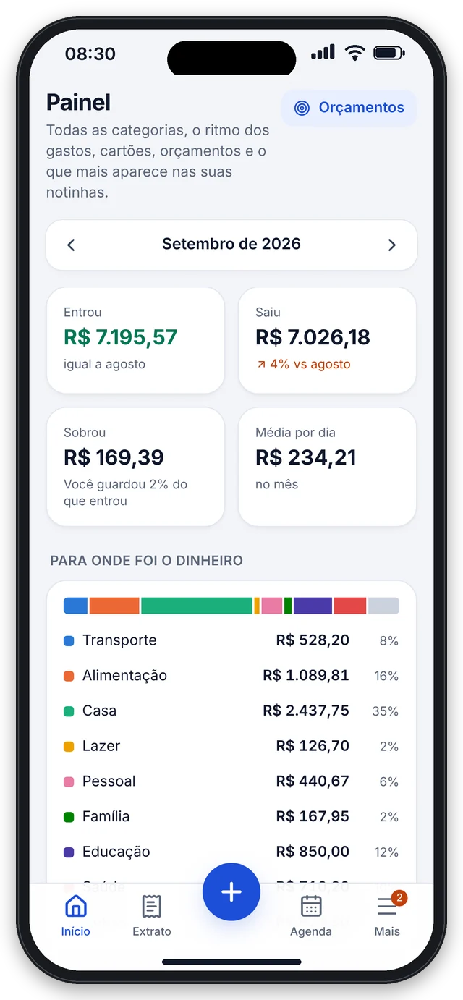
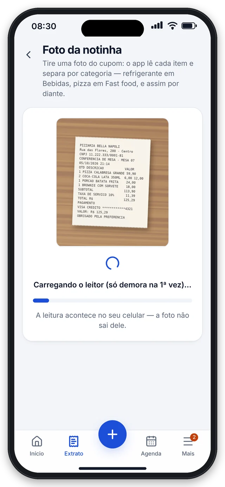

# Prumo: finanças pessoais e Imposto de Renda


App instalável no celular (PWA) que junta o extrato de todos os bancos, organiza os gastos e prepara a declaração do Imposto de Renda. Produto próprio, em fase de testes antes do lançamento.

> Este repositório é a vitrine do projeto: funcionalidades, arquitetura e decisões técnicas. O código-fonte é privado porque o Prumo é um produto comercial. Posso mostrar o código em uma conversa técnica.

## O que o app faz

- **Extrato unificado:** importa OFX, CSV, PDF ou foto de qualquer banco ou cartão, sem duplicar lançamentos.
- **Categorização automática:** regras, aprendizado com as correções do usuário e IA opcional.
- **Foto da notinha:** lê o cupom fiscal no próprio celular (OCR com Tesseract.js, sem enviar a foto) e separa cada item por categoria.
- **Agenda:** contas a pagar e a receber com repetição, lembretes e conferência automática com o extrato do banco.
- **Painel:** gráficos por categoria, ritmo de gastos, 12 meses de entradas e saídas e orçamentos com aviso em 80% e 100%.
- **Imposto de Renda mês a mês:** cálculo simplificado x completo e resumo da declaração ficha por ficha.
- **Assinatura:** cartão, Pix Automático, Pix e boleto pelo Asaas.

## Telas

| Painel | Foto da notinha |
|:---:|:---:|
|  |  |

*Telas com dados de exemplo.*

## Segurança e LGPD

- Senhas com Argon2id, login com Face ID ou digital (passkeys) e verificação em 2 etapas.
- Criptografia AES-256-GCM campo a campo (nome, e-mail, celular, CPF, descrições e arquivos), com índices cegos para as buscas.
- CSP, limites contra abuso, proteção contra robôs (Cloudflare Turnstile), bloqueio por tentativas e app que se tranca sozinho.
- Exportação e exclusão dos dados pelo próprio usuário.

## Arquitetura

```
Celular / navegador (PWA)
   │ HTTPS
   ▼
proxy.ts ── confere a sessão e monta a política de segurança (CSP)
   ▼
app/ (Next.js App Router + Server Actions)
   ├─ (auth)   entrar, cadastrar, verificar códigos, recuperar senha
   ├─ (app)    telas do app, assinatura e painel do administrador
   └─ api/     importação, notinhas, exportação e webhooks
   ▼
lib/ (regras de negócio)
   ├─ finance/   leitura de extratos e notinhas, categorias e duplicidades
   ├─ tax/       motor do Imposto de Renda
   ├─ billing/   assinatura (Asaas)
   ├─ security/  criptografia campo a campo e índices cegos
   └─ auth/      sessões, passkeys, 2 etapas e limites
   ▼
PostgreSQL (Neon) via Prisma
```

Algumas decisões:

- Valores em centavos (números inteiros) e datas de lançamento só como dia, sem erro de arredondamento nem de fuso horário.
- Campos sensíveis são criptografados automaticamente por uma extensão do Prisma, e as buscas usam índices cegos.
- A leitura da notinha roda no aparelho: só o texto vai para o servidor.
- Testes automatizados com Vitest.

## Tecnologias

Next.js 16 (App Router e Server Actions), React 19, TypeScript, Tailwind CSS 4, Prisma 7, PostgreSQL (Neon), SimpleWebAuthn, Web Push, Tesseract.js, Asaas, Resend, Twilio, Cloudflare Turnstile, Vitest e Vercel.

## Status

Em testes fechados antes do lançamento.

## Autor

**Issacar Vilarins**, Desenvolvedor Full Stack · [LinkedIn](https://www.linkedin.com/in/issacarvl/)
